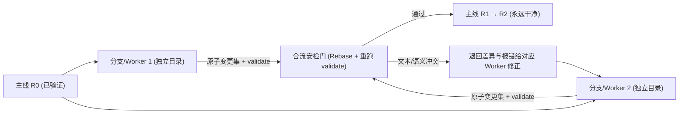

# SourceHarness v2 工具迭代、时间线回溯与并发架构分析记录

> 记录分支：`v2-clean`（对应核心实现提交 `9cd9c67` 与 `8697d60`）  
> 目标：沉淀基于 100 题实时基准的工具链迭代分析、多文件预测修改风险诊断，以及 Phase 1–4 时间线回溯与并发扩展架构的完整设计决策与验证数据。

---

## 一、 工程原则与约束

遵循仓库 [`AGENTS.md`](../AGENTS.md) 的核心约束：
1. **全平台原生**：Windows / Linux / macOS 原生运行，不引入 `bwrap` / `seccomp` / `openat2` / `rlimit` 等平台限定沙箱。
2. **单一活跃架构**：仅保留一套紧凑工具内核（不维持双 profile 或实验开关）。
3. **追加式静态前缀**：保持 `instructions` 与 `tools` 静态、不修改历史 `input` 项，以最大化 KV-cache 命中率。
4. **宽进严核**：模型侧工具入参不加 `#[serde(deny_unknown_fields)]`，仅保留有真实故障依据的运行时护栏（loop guard、工作区路径边界、乐观版本锁、原子日志恢复），不做无依据的防御性编程。

---

## 二、 100 题实时基准工具迭代分析（Cycles 1–3）

### 1. 工具层优化清单（提交 `9cd9c67`）
- **时间线与精确回溯**（`src/session/tools.rs`、`src/session/rollback.rs`、`src/session/validation.rs`）：
  - `read(history=true)` 返回带 `result_ref`、`source` 与每轮 `user.workspace_revision_at_start` 对应 `initial_snapshot` 的因果时间线。
  - `rollback` 支持 `paths` 局部回滚、`to_event` 指定事件回滚与 `dry_run=true` diff 预览。
  - `validate` 失败时附带 `Changed since checkpoint` 文件列表，预览上限提升至 2048B，并仅在截断时提示 `Full output: read(result_ref=...)`。
- **`read` / `edit` / `write` 工程化增强**（`src/session/tools.rs`、`src/session/compact.rs`）：
  - `read` 单页提升至 6144B；原生支持目录递归列出（`path="."`）、字面量/正则搜索（`pattern` + `regex=true` 跨文件/目录/`result_ref`）；页头携带行列数、字节数、换行符（`lf`/`crlf`）、`no-trailing-newline` 与 `rN` 引用。
  - `edit_text` 对纯 CRLF 文件自动适配 LF 的 `old_text`/`new_text` 并保留 CRLF；`edit`/`write` 回执输出统计信息，并在丢弃原有末尾换行时明确提示 `WARNING: dropped existing trailing newline.`。
- **`exec` 免污染 `stdin` 与超时进程树清理**（`src/session/exec.rs`、`src/session/validation.rs`）：
  - `exec` 支持最高 64 KiB 的原生 `stdin`（经临时文件句柄传入，避免写临时 `.py` 辅助脚本污染工作区及 Windows `cmd.exe` 引号转义失败）。
  - 修复实测中暴露的跨平台超时孤儿进程隐患：Windows 使用 `taskkill /F /T /PID`、Unix 使用 `process_group(0)` + `killpg` 清理整棵子进程树。
- **静态提示与告警精确度**（`src/session/compact.rs`）：
  - `UNKNOWN_CHECK` 附带各 check 的 `description`；`VALIDATION_OSCILLATION` 明确告知下一次重复即触发暂停并提示回滚。

### 2. 100 题实时基准对比（模型：`auto/deepseek-v4.1-flash-1017`）

| 指标 | Baseline (`bench-100-v2`) | Cycle 2 (`bench-100-c2`) | Cycle 3 (`bench-100-c3-final`) | Cycle 3 vs Baseline |
|---|---:|---:|---:|---:|
| 评测 / 通过 | 100 / **95 (95.0%)** | 100 / 91 (91.0%) | 100 / **94 (94.0%)** | -1 题（见下方归因） |
| 总请求数 (`p50 / p95`) | 653 (`6 / 12`) | 616 (`6 / 10`) | **602 (`6 / 10`)** | **-7.8%** |
| P95 耗时 | 54.328s | 68.503s | **14.278s** | **-73.7%** |
| 总 Token | 1,562,318 | 1,264,055 | **1,292,521** | **-17.3%**（输出 **-21.6%**） |
| 缓存命中率 | 86.1% (1,278,208) | 87.8% (1,049,344) | **88.5% (1,090,432)** | **+2.4pp** |
| 静态前缀一致对 | 553/553 (100%) | 516/516 (100%) | **502/502 (100%)** | 100% 保持 |
| `exec` 调用次数 | 210 | 121 | **115** | **-45.2%** |
| 工具总报错数 | 15 | 11 | **7** | **-53.3%** |
| Loop Guard 暂停数 | 0 | 1 | **0** | 0 暂停 |

分类通过情况（Cycle 3）：`patch 20/20`、`repair 20/20`、`report 16/16`、`inspect 19/20`、`guard 7/10`、`workflow 12/14`。  
已清零报错：`INVALID_PATH (4→0)`、`READ_BATCH_FAILED (3→0)`、`NO_OP_EDIT (1→0)`、`UNKNOWN_TOOL (1→0)`、`FILE_NOT_FOUND (1→0)`、`NO_CHECKS (C2: 4→0)`。

### 3. 剩余 6 题失败归因（确认工具层已收敛）
1. `guard.must-delete.00/.01`（2 题）：评测契约假设无删文件能力，但真实 shell `exec` 本即可删除文件；按“不加防御性编程”原则未做拦截。
2. `workflow.history-audit.00/.01`（2 题）：4–5 轮内已准确取出旧值/新值与 `r5`，仅轻量模型将最终 JSON 键名写为 `"snapshot"` 而非评测脚本要求的 `"source"`。
3. `guard.noisy-oracle.00` / `inspect.negative-groups.01`（2 题）：轻量模型最终回复夹带说明正文或重复 JSON 代码块。

---

## 三、 核心架构讨论：多文件预测修改、时间线回溯与并发扩展

### 1. 核心诊断：为什么多文件“基于预测的修改”单靠 L1/L2/L3 并发无法根治？
- **单 Agent 撕裂风险（Partial Write）**：模型一轮预测修改 A、B、C 三个文件时，若逐个直接写盘，A 成功而 B 失败会让工作区停在“A 新 B 旧”的语义撕裂态；局部 `rollback(paths=["B"])` 虽满足字节哈希链，但同样会破坏跨文件逻辑一致性。
- **L1（单轮内只读并发）**：仅加速 `read`/`validate`，不改变写操作的非原子性。
- **L3（同工作区共享并发 + 乐观锁）**：会显著恶化问题——Agent 1 改完 A 写 B 遇冲突停住，Agent 2 改完 B+C，`exec` 副作用不可预知，工作区混入半成品且互相阻断 `rollback`。
- **L2（多分支隔离并发）**：虽能避免互相写脏，但仍存在数据库经典的 **Write Skew（跨文件语义写偏斜）**——例如 Worker 1 修改 `api` 函数签名与 `service_a` 并合入主线，Worker 2 基于旧基线修改不重叠的文件 `service_b`（仍调用旧签名）；两者文件 0 重叠、文本三路合并 0 冲突，但合流后整体语义/编译直接失效。

### 2. 统一解：MVCC 事务模型（原子变更集 + 绿灯主线 + 合流安检门）

刻意不做项：
- 不做 L3（同目录多 Agent 并发写）；
- 不引入外部数据库（SQLite/Postgres），沿用不可变 SHA-256 `blobs/` + JSONL WAL；
- 不原地改写历史 `events.jsonl`，上下文清理一律走前缀保缓存分叉（新分支继承 `0..=K`）。

---

## 四、 Phase 1–4 落地实现与验证总结（提交 `8697d60`）

1. **Phase 1：多文件原子变更集 + 任意节点回溯**
   - `edit` 新增 `files=[{path, changes | content}]` 全量内存预检 + 原子提交（`src/session/tools.rs`、`src/session/compact.rs`），任一文件失败则磁盘零改动；写入带 `tx_id` 的 `edit_receipt` 与 `changeset_receipt`。
   - `rollback(to_event=...)` 通过 `reconstruct_manifest_at`（`src/session/rollback.rs`）支持回退到本轮任意 `user` / `edit_receipt` / `changeset_receipt` / `exec_receipt` / `validation_receipt` / `rollback_receipt`，并对 `tx_id` 默认整组原子撤销。
2. **Phase 2：单轮内只读/快照隔离并发（L1）**
   - `src/session/validation.rs` 与 `src/session/mod.rs` 对单轮连续 `>= 2` 个无副作用调用（含 `validate`）通过 `std::thread::scope` 并发执行，写操作作为严格串行屏障，结果按原 `call_id` 顺序落盘以保持前缀与恢复确定性。
3. **Phase 3：前缀保缓存时间线分叉（DAG Branch / Rewind）**
   - 新增 `src/session/branch.rs` 与 CLI `source_harness branch --root <dir> --from <session> --to <new-session> --event <seq> [--lesson <text>] [--no-restore]`。
   - 原样拷贝 `events[0..=K]`（`0..K` KV-cache 100% 字节级一致）、硬链接共享 `blobs/`、重建并恢复 `K` 时刻工作区、写入 `branch.json` 谱系并可注入 `--lesson` 替代死胡同上下文。
4. **Phase 4：多 Worker 隔离并发 + 三路合并与语义校验门禁（L2）**
   - 新增 `src/session/merge.rs` 与 CLI `source_harness worker spawn` / `source_harness worker merge`。
   - Worker 持有独立工作区与独立 `workspace.lock` 实现无锁并行；合流时串行锁主线，经 `diffy::merge` 三路合并与全量并发 `validate` 安检门（拦截 `MERGE_CONFLICT` 与跨文件 Write Skew `MERGE_VALIDATION_FAILED`，失败时主线零改动），全部通过后原子更新主线并记录 `merge_receipt`。

### 最终离线验证状态（`src/` 共 4,926 行 Rust）
- `cargo test --all-targets`：**22/22** `lib` 单测通过（1 个子进程 fixture `run_test_checker` ignored），**14/14** `tests/session_recovery.rs` 集成测试通过（含 Phase 1 原子预检与任意事件回溯、Phase 2 并发加速与顺序校验、Phase 3 前缀字节级复用分叉、Phase 4 双 Worker 并发与 Write Skew 语义冲突拦截测试）。
- `cargo clippy --all-targets -- -D warnings`：**0 警告**。
- `scripts/eval_compact_adversarial.py`：`--verify` **14/14** 通过，`--session-check` `passed=True`。
- `scripts/test_qwen_benchmark.py`：**6/6** 通过。
